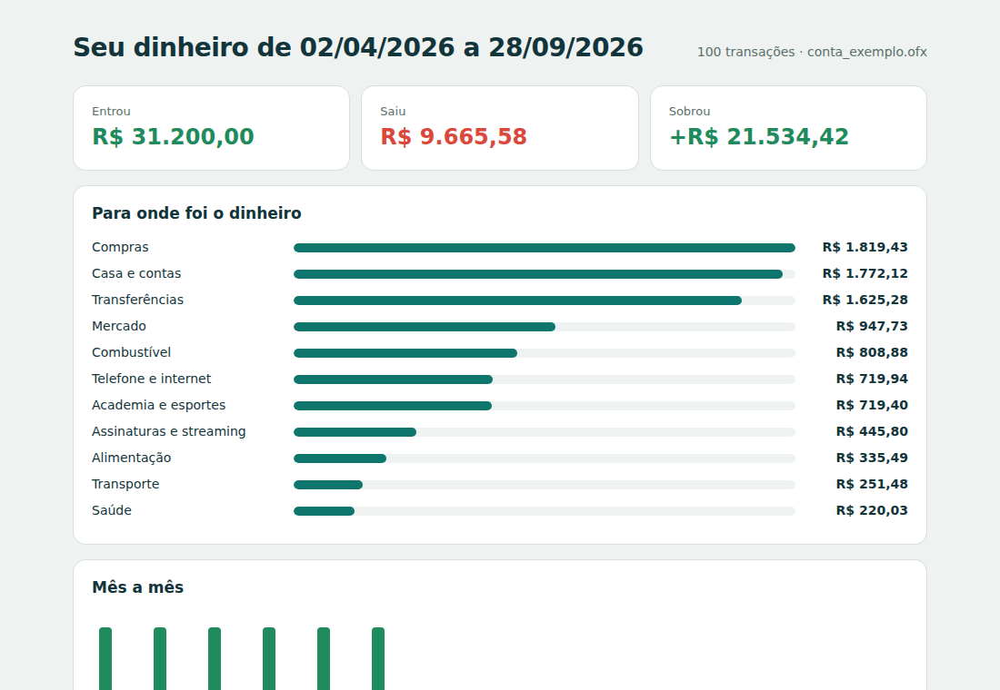

<p align="center">
  <picture>
    <source media="(prefers-color-scheme: dark)" srcset="assets/logo-dark.svg">
    
  </picture>
</p>

<p align="center">
  <a href="https://github.com/yagodejesus/spendscope/actions/workflows/ci.yml"></a>
  <a href="https://pypi.org/project/spendscope/"></a>
  <a href="https://pypi.org/project/spendscope/"></a>
  <a href="LICENSE"></a>
</p>

**Entenda para onde vai o seu dinheiro: leia extratos e faturas de qualquer banco e descubra assinaturas esquecidas, aumentos de preço, parcelas a vencer e cobranças em dobro.**

> 🇺🇸 *Make sense of Brazilian bank statements and credit-card bills (OFX or CSV from any bank): automatic categories, forgotten subscriptions, price increases, remaining installments and duplicate charges — with a one-file HTML report. Everything runs offline.*

```bash
pip install spendscope
spendscope extrato-nubank.ofx fatura-itau.csv --html relatorio.html
```

<p align="center"></p>

## O que ele encontra

- **Assinaturas e cobranças recorrentes** — mensais, semanais, anuais… com o custo por ano e a data da próxima cobrança. Duas cobranças de um serviço de streaming já bastam para aparecer.
- **Aumentos de preço** — "sua assinatura ficou 33% mais cara em julho". Contas que oscilam (luz, água) não disparam alarme falso.
- **Parcelamentos** — `PARC 07/10`, `Parcela 2/6`, `- 4/12`: quanto ainda falta pagar e quando termina.
- **Cobranças em dobro** — mesmo estabelecimento, mesmo valor, no mesmo dia ou no dia seguinte.
- **Categorias automáticas** em português, com regras para os nomes que aparecem nas faturas brasileiras (iFood, Uber, 99, Equatorial, Cosanpa, Sabesp, Drogasil, Magalu, Mercado Livre…) — e você pode adicionar as suas.
- **Nomes legíveis** — `COMPRA CARTAO DEBITO MP *ACAIDAMARIA 15/01` vira `Acaidamaria`.

## Privacidade

Seus extratos não saem do seu computador: não há servidor, conta, telemetria nem dependência externa. O relatório HTML é um arquivo único que abre offline.

## Formatos aceitos

| Formato | Detalhes |
|---|---|
| **OFX** 1.x (SGML) e 2.x (XML) | o padrão que quase todos os bancos exportam (conta e cartão); lê saldo, conta e codificação Windows-1252 |
| **CSV** | separador `,` `;` tab ou `|`; colunas reconhecidas pelo nome (`Data`, `Descrição`/`Histórico`/`title`, `Valor`/`amount` ou `Crédito` + `Débito`); valores como `R$ -1.234,56`, `(12,00)` ou `1.234,56-`; datas `dd/mm/aaaa` ou `aaaa-mm-dd` |

Faturas de cartão em CSV costumam trazer as compras como valores **positivos**. O `spendscope` percebe isso sozinho (ou use `--cartao`). Vários arquivos podem ser lidos juntos — conta, cartão, bancos diferentes — e transações repetidas são ignoradas.

## Linha de comando

```bash
spendscope conta.ofx                              # relatório no terminal
spendscope conta.ofx fatura.csv --html r.html     # relatório visual
spendscope *.ofx --de 2026-01-01 --ate 2026-06-30 # só um período
spendscope conta.ofx --csv categorizado.csv       # para abrir no Excel / Sheets
spendscope conta.ofx --regras minhas_regras.json  # suas categorias
```

```text
Assinaturas e cobranças recorrentes
  Equatorial Para               R$ 227,37 mensal        R$ 2.728,44/ano  próxima ~16/10/2026
  Smart Fit                     R$ 119,90 mensal        R$ 1.438,80/ano  próxima ~21/10/2026
  Netflix                        R$ 59,90 mensal          R$ 718,80/ano  próxima ~11/10/2026  ▲ 33% mais cara
  Total por ano: R$ 7.538,52

Parcelamentos em andamento
  Magazine Luiza              7/10 de    R$ 189,90  faltam R$ 569,70 (até dez/26)
```

## Python

```python
import spendscope

e = spendscope.ler("conta.ofx", "fatura.csv", regras={"Academia": ["smart ?fit", "bodytech"]})

e.entradas, e.saidas                 # Decimal
e.por_categoria()                    # {'Mercado': Decimal('947.73'), ...}
e.por_mes()                          # {'2026-04': {'entradas': ..., 'saidas': ...}, ...}

for r in e.recorrentes():
    print(r.estabelecimento, r.periodicidade, r.custo_anual, r.aumento)

e.parcelamentos()                    # compras parceladas e o compromisso futuro
e.duplicadas()                       # pares suspeitos
e.filtrar(categoria="Alimentação")   # um novo Extrato só com o filtro
e.to_dataframe()                     # pandas (opcional)
e.relatorio_html("relatorio.html")
```

### Suas regras de categoria

Um JSON com categorias e expressões regulares (sem diferenciar maiúsculas nem acentos). Elas têm prioridade sobre as regras padrão:

```json
{
  "Academia": ["smart ?fit", "bodytech"],
  "Açaí (vício assumido)": ["acai"]
}
```

## Experimente sem seus dados

O repositório tem um extrato fictício de seis meses em [`exemplos/conta_exemplo.ofx`](exemplos/conta_exemplo.ofx), gerado por [`exemplos/gerar_exemplos.py`](exemplos/gerar_exemplos.py):

```bash
spendscope exemplos/conta_exemplo.ofx --html exemplo.html
```

## Limitações

- As categorias são por regras: o que não casar com nenhuma vai para "Outros". Contribuições de regras são muito bem-vindas.
- Transferências (Pix, TED) entram como saídas na categoria "Transferências" — o `spendscope` não sabe se foram para você mesmo em outra conta.
- Detectar recorrência precisa de histórico: use pelo menos três meses de extrato.

## Desenvolvimento

```bash
git clone https://github.com/yagodejesus/spendscope && cd spendscope
pip install -e ".[dev]"
pytest && ruff check .
```

## Licença

MIT © Yago de Jesus Martins
